# Rostrum

[](https://github.com/lukeeexd/rostrum/actions/workflows/ci.yml)
[](LICENSE)

**A monitoring dashboard for [Podium](https://github.com/lpukatch/podium)**, the
stream checker and reorderer for [Dispatcharr](https://github.com/Dispatcharr/Dispatcharr)
(a self-hosted IPTV channel manager).

Podium probes your IPTV streams, decides which one each channel should serve
first, and reorders Dispatcharr to match. Its own UI is for setting that up.
Rostrum is the screen you leave open to see how it's going: which channels are
healthy, which providers are letting you down, what changed overnight, and
why.

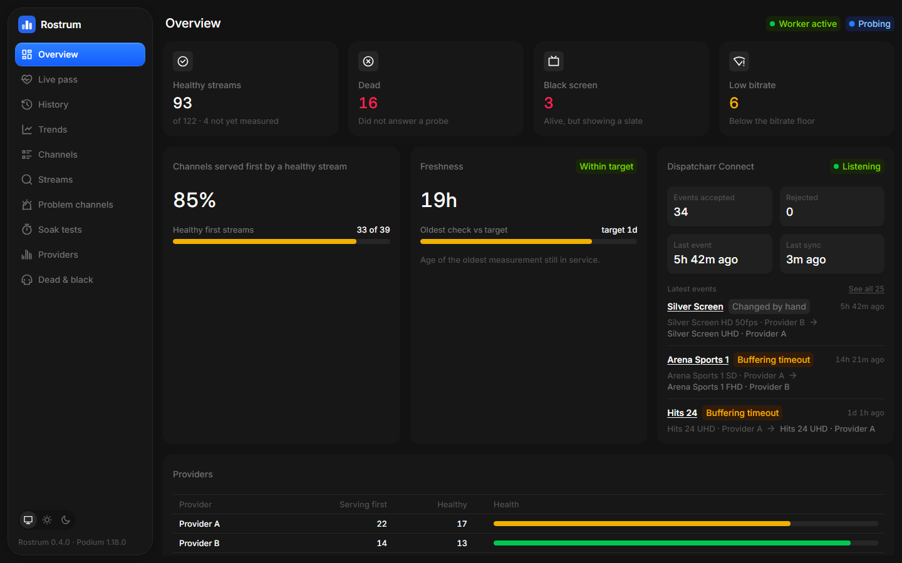

- **Read-mostly.** It shows what Podium has measured. The only things it can
  change are queuing a re-check or a soak, the same requests Podium's own buttons make.
- **Remembers what Podium forgets.** Podium keeps its last 30 passes and each
  stream's latest soak. Rostrum records snapshots, soak results, Dispatcharr
  Connect events and every channel's slot 1 for 90 days, so you can look back
  a week or a month.
- **Small and self-contained.** One container, one SQLite file, no login to
  set up, nothing else to run.

> The screenshots here come from `npm run demo`, which runs Rostrum against a
> made-up Podium. Every channel, stream and provider in them is invented.

## Try it without a Podium

```sh
git clone https://github.com/lukeeexd/rostrum && cd rostrum
npm install
npm run demo        # builds the app, then open http://localhost:8090
```

The demo starts a fake Podium with an invented catalogue (about 40 channels,
three providers) and a week of invented history, and runs Rostrum against it.
Nothing real is touched, and the re-check and soak buttons work against the
fake. It needs Node 24; the first run takes a little longer while it builds.

## What you get

| | |
| --- | --- |
| 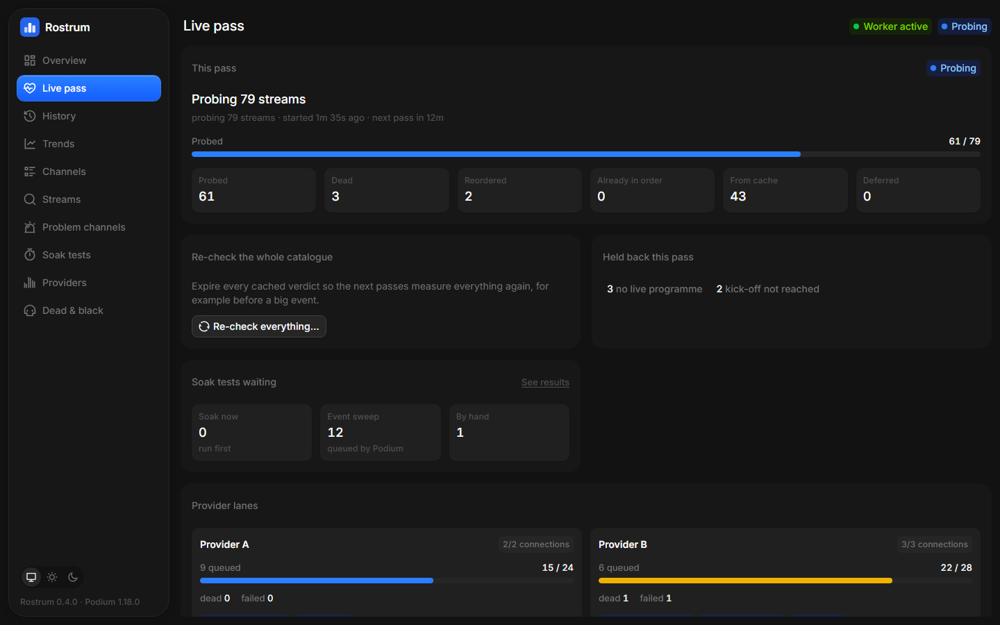 | **Live pass.** The pass in progress: probe progress, each provider's lane draining against its connection limit with the streams in flight, what was held back and why, soak tests waiting, and when the next pass starts. |
| 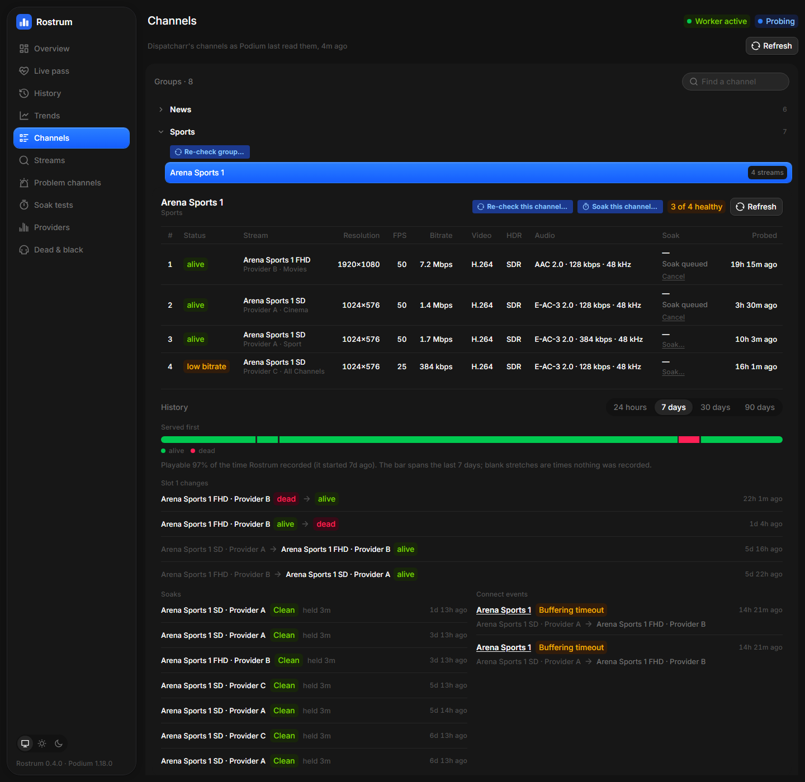 | **Channels.** Dispatcharr's groups and channels. Open one to see its streams in Dispatcharr's order with what Podium measured: status, resolution, FPS, bitrate, codecs, HDR, audio, last soak. Below that is the channel's history: what it served first, how often that was playable, every time slot 1 changed, its soaks and its Connect switches. Re-check the channel or its group, or soak a stream or the whole channel, from here. |
| 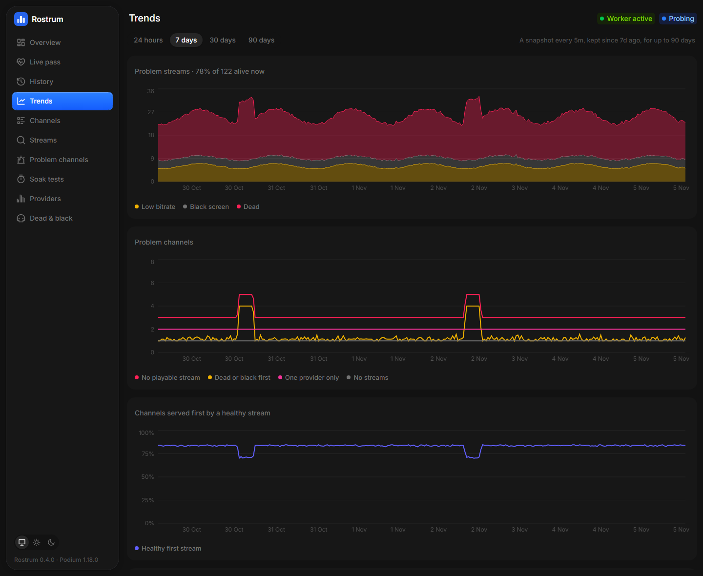 | **Trends.** 24 hours to 90 days of problem streams, problem channels, channels served first by a healthy stream, freshness against Podium's target, and each provider's health, score and bitrate. |
| 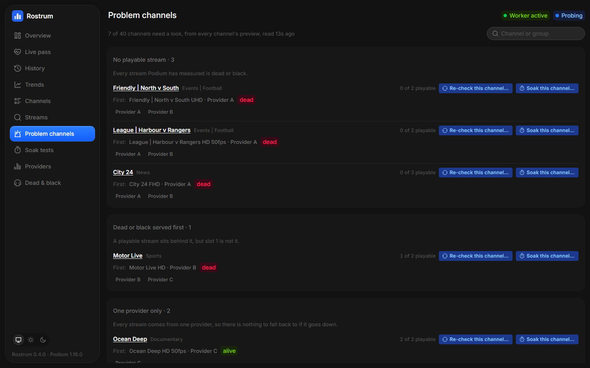 | **Problem channels.** Every channel sorted by what's wrong with it: no playable stream, a dead stream served first with a good one behind it, only one provider to fall back on, no streams at all. Channels Podium hasn't measured yet are folded away. |
| 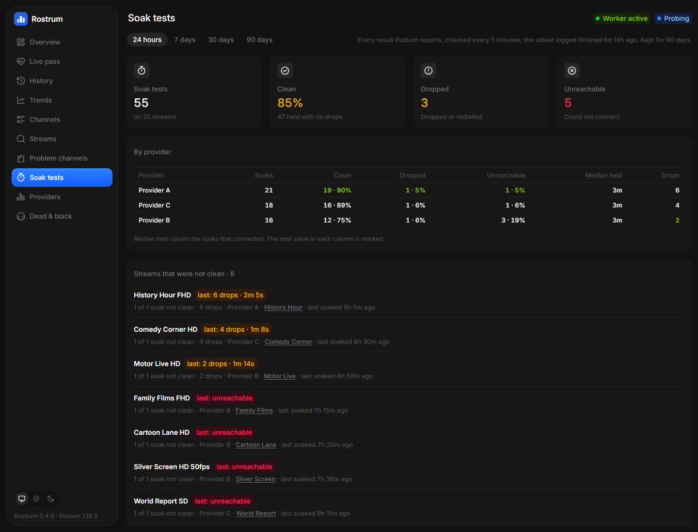 | **Soak tests.** Every soak result over time: clean, dropped or unreachable; each provider's record and median time held; the streams that keep failing, worst first. |
| 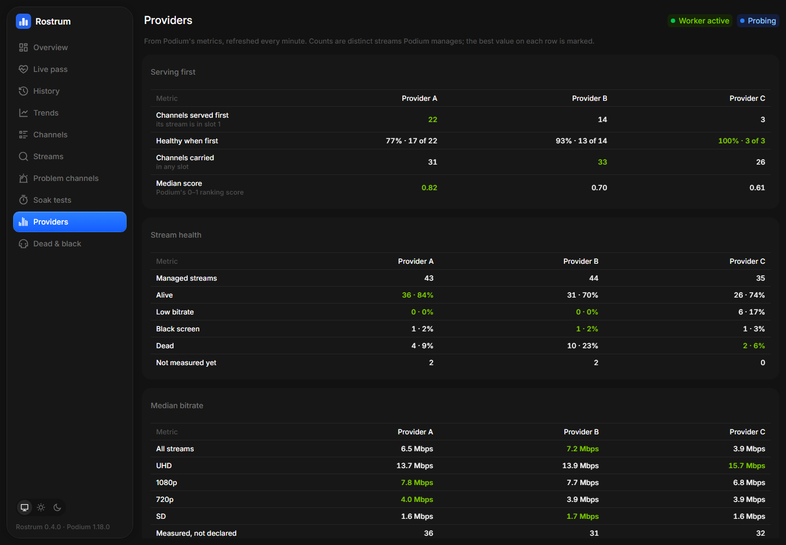 | **Providers.** Your providers side by side: channels served first and how healthy, median score, stream health, bitrate by resolution, resolution mix, verdict age, and why dead streams died. The best value on each row is marked. |
| 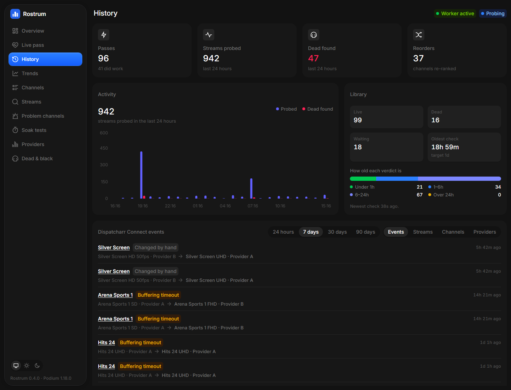 | **History.** The last 24 hours of passes, probes, dead streams found and reorders, how old the cached verdicts are, and the Dispatcharr Connect log: each time a stream failed or was switched while someone was watching, ranked by stream, channel and provider. |
| 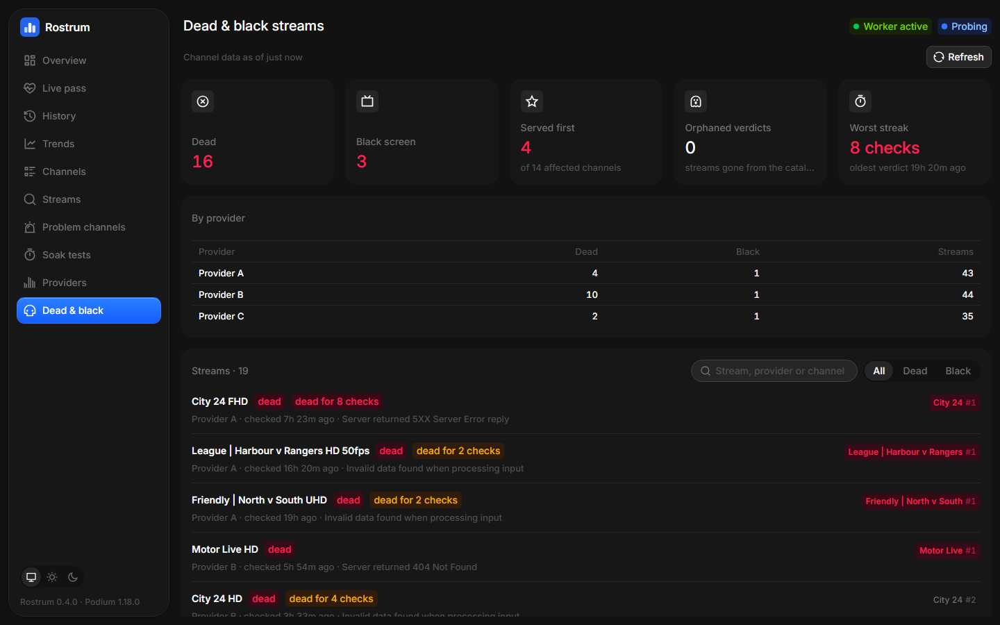 | **Dead & black.** Every dead or black-screen stream, with the channels it sits on and its rank there, filterable, with a breakdown by provider. |
| 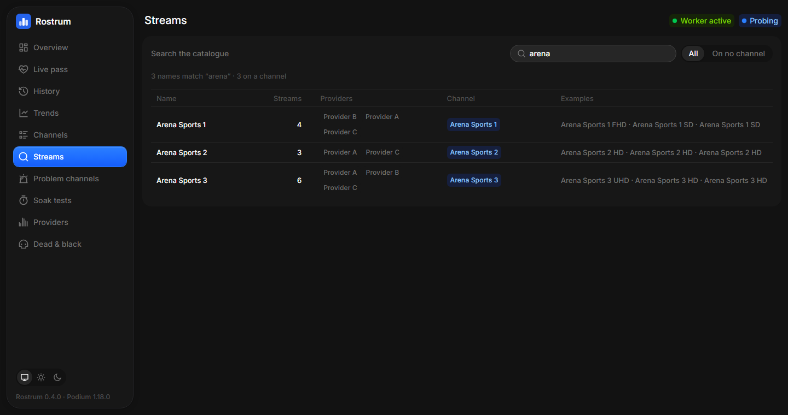 | **Streams.** Search the whole catalogue by name, grouped the way Podium matches streams, with the providers carrying each and the channel that claims it, or "on no channel" for feeds nothing picks up yet. |

It refreshes itself (every 2 s while a pass is probing, every 10 s
otherwise) and stops polling while the tab is hidden. Light and dark follow
your system, or pick one. It works on a phone and uses the room on a wide
screen:

| | |
| --- | --- |
| 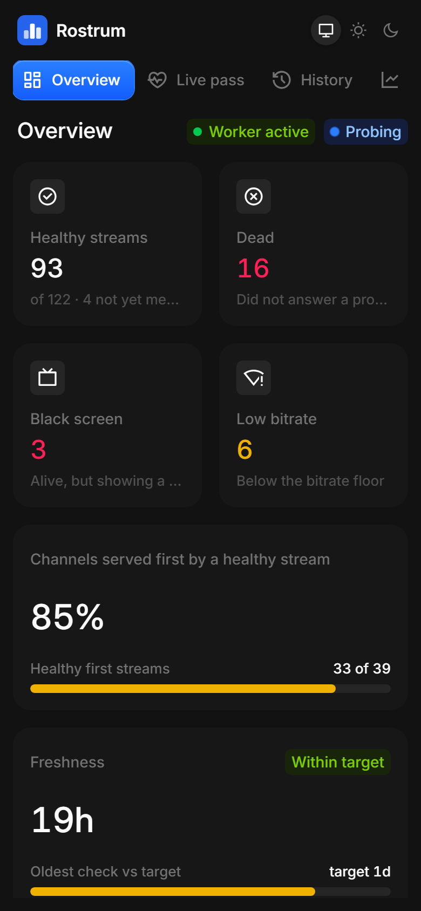 | 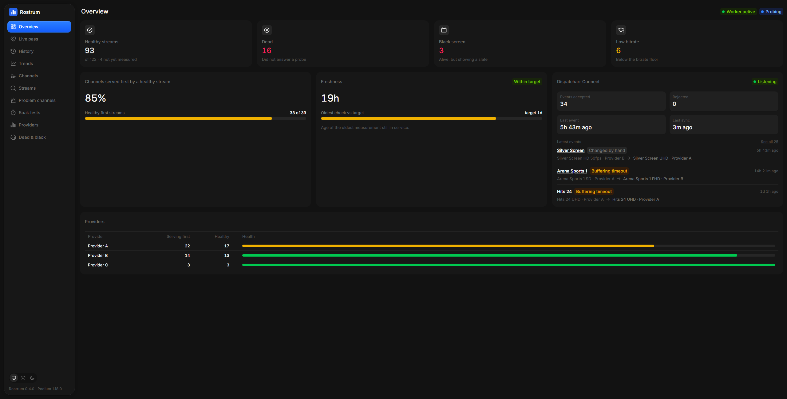 |

## Run it

Rostrum is published as a container image for amd64 and arm64. Next to
[`docker-compose.yml`](docker-compose.yml), create a file named `.env` with
your Podium's address:

```ini
PODIUM_URL=http://192.168.1.10:3456
PODIUM_TOKEN=
```

Then start it with `docker compose up -d` and open <http://localhost:8080>.

Rostrum has no login, so the compose file only listens on `127.0.0.1`; read
[Who can reach it](#who-can-reach-it) before opening it up. To build the
image yourself instead: `docker build -t rostrum .`

| Variable | Required | Default | Meaning |
| --- | --- | --- | --- |
| `PODIUM_URL` | yes | | Podium's base URL, origin only (no path) |
| `PODIUM_TOKEN` | no | | Podium's `PODIUM_AUTH_TOKEN`, if set. Used only by Rostrum's server, never sent to the browser |
| `PORT` | no | `8080` | Port the server listens on (`npm start` and dev; with Docker, change the published port in the compose file instead) |
| `DISPATCHARR_URL` | no | | Dispatcharr's base URL, for per-stream FPS, codec and audio (see below) |
| `DISPATCHARR_API_KEY` | no | | A Dispatcharr API key. Set both or neither |
| `HISTORY_DB` | no | `/data/rostrum.db` in the image (already set; for `npm start` and dev) | The SQLite file for everything Rostrum records: Trends snapshots, the soak log, the Connect log and each channel's slot-1 history (90 days, a few tens of MB). The compose file keeps it on the `rostrum-data` volume. Unset, those pages say history is off. To start over, stop Rostrum and remove the volume |
| `ROSTRUM_ALLOWED_HOSTS` | no | | Extra names Rostrum answers to, beyond private IPs and `.lan`/`.local`/`.home.arpa`/`.ts.net` names: for example the name a reverse proxy serves it on (`rostrum.example.com`). Comma or space separated; `.example.com` or `*.example.com` match subdomains, `*` matches anything. A pasted URL works too. The startup log lists what is in effect, and a refused name is logged once |

**Use an IP or a `.lan`/`.local` name in `PODIUM_URL`.** Podium only answers
to private addresses and names unless you add others to its
`PODIUM_ALLOWED_HOSTS`, so a Docker service name like `http://podium:3456`
is refused. Add it there if you run both on one compose network.

**FPS, codec and audio on the Channels page.** Podium measures them on every
probe. A Podium whose channel preview reports them (the `last*` fields) is
used directly. Otherwise, with `PODIUM_WRITE_STATS` on (Podium's default),
Podium writes the full probe result into each stream's `stream_stats` in
Dispatcharr, and Rostrum reads it from there when `DISPATCHARR_URL` and
`DISPATCHARR_API_KEY` are set. Without either, the page still shows status,
height and bitrate.

**Images.** `ghcr.io/lukeeexd/rostrum:latest` tracks `main`. Each release
`vX.Y.Z` also publishes `X.Y.Z` and `X.Y`: pin `:0.4` to take fixes but
choose when to move to a new minor version. `/healthz` and the sidebar show
the running version.

## What it can change

Rostrum shows; Podium decides. Rostrum can make only these changes, and each one
only queues a request that Podium carries out on its next pass, within its usual
limits. Nothing is probed, soaked or reordered on the spot.

- **Queue or cancel a re-check** of the whole catalogue, one channel group,
  or one channel (on a Podium whose re-check list includes `channels`). This
  writes the same mark as Podium's own re-check buttons: cached verdicts
  expire, and Podium measures them again.
- **Queue a soak** of one stream or one channel, or cancel a stream's.
  Podium holds the stream open for its configured soak length to count drops,
  when a pass has spare capacity and nobody is watching. A channel soak
  leaves out streams that are already dead.

## Who can reach it

Rostrum has no login. Its server is a narrow proxy in front of Podium:

- **Only what the pages need reaches Podium.**
  - Reads: six endpoints (health, stats, progress, dead, the soak queue, and
    the list of queued re-checks).
  - Re-check writes: exactly `POST /api/refresh` with `{"scope":"all"}`,
    `{"scope":"group","groupId":<id>}` or `{"scope":"channel","channelId":<id>}`,
    and the matching `DELETE`s.
  - Soak writes: exactly `POST /api/soak` with
    `{"scope":"stream"|"channel","id":<id>}` and
    `DELETE /api/soak?streamId=<id>`. The bare `DELETE`, which would empty
    Podium's whole soak queue, is refused.

  Write bodies are rebuilt from the parsed values, not passed through.
  Everything else (settings, backups, rule edits, applying orderings) is
  refused before it reaches Podium.
- **Rostrum's own pages read through `/api/rostrum/*`.** Those reads use
  Podium's cached state, its read-only channel preview, its catalogue search,
  its metrics and its Connect status, plus, if configured, Dispatcharr's
  stream stats. They return only the fields the pages show.
  - The history pages read Rostrum's own database (`?range=24h|7d|30d|90d`; any
    other range is refused).
  - To fill that database, Rostrum walks every channel's preview every 5
    minutes. That's the same read-only call the Channels page makes (no probing, no
    Dispatcharr calls), four channels at a time; each is a quick read of Podium's
    cache.
- **Load on Podium is bounded.**
  - Podium's state is reused for 10 seconds.
  - Searches (2 to 100 characters, at most 200 results) and provider metrics
    are reused for 30 seconds, and Dispatcharr stats for 60.
  - The preview walk is reused for a minute, and a failed walk isn't retried
    for 30 seconds.
  - Identical requests in flight are shared, and at most four Dispatcharr
    calls run at once.
- **Requests are checked at the door.**
  - It answers only to private addresses and LAN-style names (plus
    `ROSTRUM_ALLOWED_HOSTS`), like Podium, so a site that re-points its own
    domain at your LAN (DNS rebinding) gets a 403.
  - It refuses cross-site writes the same way Podium does, so a page you
    visit can't queue anything through your browser. This relies on the
    browser's `Origin`/`Sec-Fetch-Site` headers.
  - Browser headers aren't forwarded. The token is added server-side.
- **Provider logins never reach the browser.** Provider stream URLs carry the
  IPTV account's login, so every string Rostrum returns has its URLs cut down
  to the host. Credentials written without a scheme (`user:pass@host`,
  `?username=…&password=…`, `/live/<user>/<pass>/` paths) are masked too.
  Dispatcharr's stream records never leave the server.
- **The page itself is locked down.** It's served with a strict
  Content-Security-Policy (`script-src 'self'`).

**Anyone who can reach the port can read your stream health and queue a
re-check or a soak.** The compose file binds to `127.0.0.1`. Widen that only
on a network you trust, or put Rostrum behind an authenticating reverse proxy.
A Dispatcharr API key can do anything in Dispatcharr, so treat Rostrum's
environment as sensitive once it holds one, and use plain `http://` for
`DISPATCHARR_URL` only on a network you trust.

## Develop

```sh
cp .env.example .env    # point PODIUM_URL at your Podium
npm install
npm run dev             # http://localhost:5173, against your Podium
npm run demo            # or http://localhost:8090, against the made-up one
npm test
npm run build && npm start
```

`npm run dev` mounts the same backend the container runs
(`server/backend.ts`) inside Vite, so the allowlist and header handling are
identical in dev.

`npm run capture-fixtures` snapshots your Podium's responses into
`src/test/fixtures/`, which the tests run against. On the way in:

- URLs are scrubbed, and provider patterns are blanked.
- Provider names, provider group names and provider-style stream names are
  anonymised (`Provider A`, `Group 1`, plain channel names).
- A file that still holds a real provider name isn't written.

Channel names are kept, so review the files before committing.

```
server/            Hono server: config, host guard, the allowlisted Podium proxy,
                   static files, and the composed reads (channels, catalogue, problems,
                   Connect events) over the podium.ts / dispatcharr.ts clients and
                   load.ts (caching, limits). streams-index.ts is the shared walk of
                   every channel preview; history.ts keeps the SQLite record (snapshots,
                   soaks.ts, connect-log.ts, channel-heads.ts).
scripts/           build-server.mjs, capture-fixtures.mjs + anonymise.mjs, and demo/
                   (the made-up Podium and its seeded history behind `npm run demo`)
src/api/           Podium and Rostrum types, fetch client, TanStack Query queries
src/app/           router, app shell, theme toggle
src/features/*/    one folder per page; pure logic in lib/ with tests beside it
src/components/ui/ vendored BoardUI (see its README); don't edit
src/components/shared/  Rostrum's own building blocks on top of BoardUI
docs/screenshots/  the README's screenshots, taken from the demo
```

### Releases and updates

Bump `version` in `package.json`, commit, then push a matching tag
(`git tag v0.5.0 && git push origin v0.5.0`). CI checks that the tag matches
`package.json`, publishes the `0.5.0` and `0.5` images, and creates a GitHub
Release with notes generated from the commits since the previous tag.

CI runs on `ubuntu-24.04`, with GitHub Actions pinned to commit SHAs.
Dependabot opens monthly PRs:
- npm packages: one PR for all minor and patch bumps, and one per major version
- GitHub Actions: one PR for all of them
- the Docker base image: one per update

Node itself (the `node` image and `@types/node`) moves to a new major by
hand, once that major is LTS.

## Security

Please report security problems privately, through
[GitHub's private vulnerability reporting](https://github.com/lukeeexd/rostrum/security/advisories/new),
not in a public issue.

## Credits and licence

Rostrum is an independent project. It isn't affiliated with or endorsed by Podium or
Dispatcharr; it only talks to their APIs. It's built against Podium 1.17 and
later.

UI components and styles are from [BoardUI](https://github.com/BoardUI/boardui)
(MIT, see [`src/components/ui/LICENSE`](src/components/ui/LICENSE)).

Rostrum itself is released under the [MIT licence](LICENSE).
